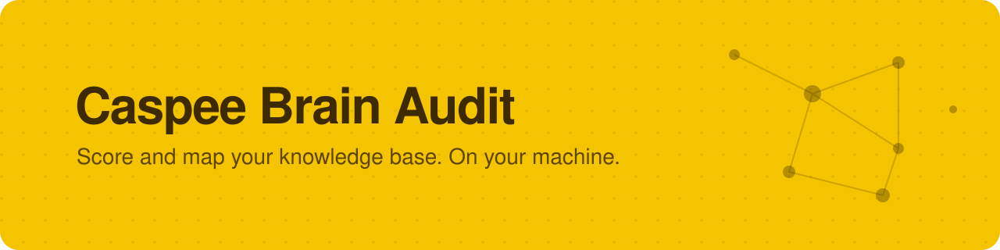
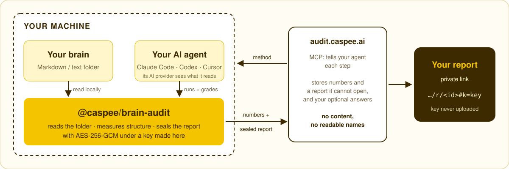

<div align="center">



<p>
<a href="https://www.npmjs.com/package/@caspee/brain-audit"></a>

<a href="LICENSE"></a>
<a href="https://audit.caspee.ai"></a>
<a href="https://caspee.ai"></a>
</p>

**The source of [`@caspee/brain-audit`](https://www.npmjs.com/package/@caspee/brain-audit): read exactly what runs on your machine, rebuild it, and check it is what npm serves.**

[Use the CLI](cli/brain-audit/README.md) · [Privacy](#privacy-in-short) · [What is here](#what-is-here) · [Build and verify](#build-and-verify) · [Licence](#licence)

</div>

---

A small command-line program that audits a company brain — a folder of Markdown or plain text —
on your own machine. It measures the folder's structure (links, metadata, dating, duplicates),
lets your AI agent grade how well it covers what a company needs written down, and uploads
only numbers and an encrypted report. It is the local half of the
[Caspee brain audit](https://audit.caspee.ai).

<p align="center"></p>

**To run an audit**, start at [audit.caspee.ai](https://audit.caspee.ai) or read
[`cli/brain-audit/README.md`](cli/brain-audit/README.md): it has the quickstart for Claude
Code, Codex and Cursor, and every command.

## Privacy, in short

- `extract` downloads the audit's method (one request) and sends only the audit id, its token and the CLI version; then it reads the
  folder on your machine.
- Before grading and the report link, the agent running the audit asks three short optional
  questions (how happy you are with your brain, how many people use it, what for) and sends the
  answers you choose to give, with its guess of how your brain is served to agents, through the
  audit's MCP server. This CLI sends none of it.
- `finish` makes one request, to `--api` (by default `https://audit.caspee.ai`; another host
  only with `--unsafe-api-host`): a plain summary (scores, counts and fixed category words) and
  a report sealed with AES-256-GCM under a key made on your machine.
- The key is made on your machine and never uploaded: it is kept in the report link, after
  `#k=`, which browsers never send to a server, and in the audit's local work files until
  `brain-audit clean` removes them. The link is built on your machine, never taken from the
  server.
- No telemetry, no update check. `test/mirror.test.mjs` (run by `npm test` and in CI) checks
  that the upload carries no file path and no key, that the link stays on the `--api` origin
  whatever the server answers, that an unknown `--api` host is refused before any request, and
  that `clean` removes the work files.

## What is here

| Path                   | What                                                                                                                                                                                                        |
| ---------------------- | ----------------------------------------------------------------------------------------------------------------------------------------------------------------------------------------------------------- |
| `cli/brain-audit/`     | the CLI: its commands (`src/`), its build (`build.mjs`), its `package.json`, README and licence                                                                                                             |
| `src/lib/`             | the audit code the CLI bundles; [`src/lib/README.md`](src/lib/README.md) walks through it                                                                                                                   |
| `package.json`         | the build's tool (esbuild), the type checker (TypeScript, Node's types) and the open-source packages the bundle contains, at exact versions                                                                 |
| `bundle.expected.json` | the digest of the released bundle and the list of files it is built from                                                                                                                                    |
| `test/mirror.test.mjs` | the rebuild check, and end-to-end runs on a synthetic brain and a synthetic method (`test/fixtures/`) against a local fake server, including a server that answers with another host and a refused one      |
| `.github/workflows/`   | `ci.yml` (type-check, build and test on Node 20, 22 and 24), `publish.yml` (publish to npm with provenance on a tag, after an approval in the `npm` environment); the actions they use are pinned by commit |

## The method

What the audit measures against — the catalogue of business elements, the rubric the agent
grades with, the weights, the page shapes and the conventions — is the audit's **method**. It
is not in this code or in the bundle: `extract` downloads it from the audit server for each
audit (with the audit's token), checks its hash, keeps it in the work directory, and `finish`
scores with that copy. The code here is the engine that applies whatever method it is given. General rules for reading any folder of notes stay in the code: file formats, link and date syntax, the files of note-taking tools (Obsidian, Logseq, Notion exports), and common header words for access, people and sources.
For its own tests this repository carries a synthetic method (`test/fixtures/method.json`:
made-up elements, page shapes, conventions and round weights), which the fake server in
`test/mirror.test.mjs` serves.

The bundle has no runtime dependencies beyond Node's built-ins; graphology (community
detection for the report's map of the brain) is compiled in.

## Build and verify

```sh
npm ci
npm run check    # type-checks the CLI and the audit code (tsc --noEmit)
npm run build    # writes cli/brain-audit/dist/brain-audit.mjs
npm test         # the rebuilt bundle is the released one; then end-to-end runs
```

The test compares the sha256 of the bundle you just built with `bundle.expected.json`. The
bundle names each module it contains by its path, and a package manager other than npm lays
out `node_modules` differently, so the check puts those module paths in one form first
(`cli/brain-audit/scripts/bundle-digest.mjs`); nothing else is rewritten.

Every release on npm is published from this repository by `publish.yml`, with
[provenance](https://docs.npmjs.com/generating-provenance-statements): the package page on
npmjs.com shows the commit and workflow that built it, and `npm audit signatures` verifies it. To compare a
published version with this source yourself:

```sh
npm pack @caspee/brain-audit@<version>
tar -xzf caspee-brain-audit-<version>.tgz
git checkout v<version> && npm ci && npm run build
cmp package/dist/brain-audit.mjs cli/brain-audit/dist/brain-audit.mjs
```

## How this repository is made

The audit code is shared with the Caspee platform, which runs the same structural audit on a
brain brought to it, so a score here and there agree. Each release, this repository is
generated from that code and replaced whole, one commit per release: exactly the files the
bundle is built from, plus the build, the tests and this documentation. The shared modules
come without their internal comments, and those outside the audit core are gathered in
`src/lib/shared/`. It does not take pull requests; issues are welcome.

## Licence

Proprietary: you may install and run the CLI to audit content that you own or are allowed to
audit, for yourself or for the organisation you work for, and read, clone and build this code
to check it; you may not modify or redistribute it, or use it to build a service that audits,
scores, builds or hosts knowledge bases for other parties. Licensor: OneType P.S.A. See
[LICENSE](LICENSE). The open-source packages the bundle contains keep their own licences
(`cli/brain-audit/THIRD-PARTY-NOTICES.md`).

## Links

- Run the audit: <https://audit.caspee.ai>
- Privacy policy: <https://audit.caspee.ai/privacy>
- Caspee: <https://caspee.ai>
