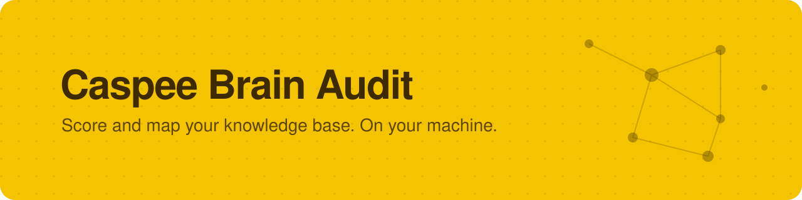
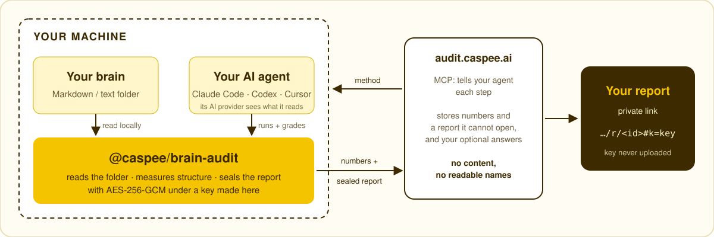

<div align="center">



<p>
<a href="https://www.npmjs.com/package/@caspee/brain-audit"></a>

<a href="LICENSE"></a>
<a href="https://audit.caspee.ai"></a>
<a href="https://caspee.ai"></a>
</p>

**Find out what your AI agents actually know: a free audit of your company brain, run on your own machine.**

[Why](#why-audit-a-brain) · [What you get](#what-you-get) · [Quickstart](#quickstart) · [How it works](#how-it-works) · [Privacy](#privacy) · [Commands](#commands) · [Licence](#licence)

</div>

---

## Why audit a brain

Teams now keep a "brain" for their AI agents: a folder of Markdown or text that holds what the
company, or one person, knows. Agents answer from it, so its quality is your agents' quality.

Brains rot quietly. Pages get duplicated, go stale, lose their links or never get written, and
nothing fails loudly: the agent just answers from what is there, wrong or missing. Nobody
measures it, so nobody sees it.

The Caspee Brain Audit measures it. Your own agent runs this CLI on your folder and you get a
score, a map and the fixes that matter most. No file content reaches Caspee: to grade merit,
your agent reads some of your files, under the terms you have with its AI provider.

## What you get

A private report with two audits and what to do about them:

| Part                  | What it shows                                                                                         |
| --------------------- | ----------------------------------------------------------------------------------------------------- |
| **Structural audit**  | Dead, ambiguous and outside links, orphans, dead ends, undated and stale pages, uncited evidence.     |
| **Merit audit**       | Does the brain cover what a business like yours needs to know? Graded by your agent against a rubric. |
| **Tree**              | Your brain's folders and files as one browsable map, each file with its own findings.                 |
| **Constellation**     | Every page as a star and every link as a line: the clusters, the bridges and what floats alone.       |
| **Summary and score** | One score out of 100 from structure and merit, with the measures behind it.                           |
| **Top 5 fixes**       | The five changes that matter most, each with how to fix it by hand, then the full list file by file.  |

It reads any folder of Markdown or text: a company brain, a docs repo, an Obsidian or Logseq
vault, a Markdown export of a wiki.

## Quickstart

You need Claude Code, Codex or Cursor, Node.js 20 or newer, and an email address you can read.

**1. Connect your agent** to the audit's MCP server, `https://audit.caspee.ai/mcp`:

```sh
# Claude Code
claude mcp add --transport http --scope user brain-audit https://audit.caspee.ai/mcp

# Codex
codex mcp add brain-audit --url https://audit.caspee.ai/mcp
```

Cursor: add this to `~/.cursor/mcp.json` (every project) or `.cursor/mcp.json` (one project):

```json
{ "mcpServers": { "brain-audit": { "url": "https://audit.caspee.ai/mcp" } } }
```

**2. Ask your agent:**

> Run the Caspee brain audit on my brain folder.

The MCP tells your agent each step: it confirms your email with a 6-digit code, runs
`npx @caspee/brain-audit` on your folder, confirms your company type with you, asks three
short optional questions, grades merit and hands you the report link. [audit.caspee.ai](https://audit.caspee.ai) has the same setup
for each agent, plus a small skill or rule that keeps the agent on the audit's steps.

The audit is free. In return, OneType P.S.A. (Caspee) contacts you by email about your result
and about Caspee; you can stop that at any time. See the
[privacy policy](https://audit.caspee.ai/privacy).

## How it works

<p align="center"></p>

| Step        | Where        | What crosses the network                                                    |
| ----------- | ------------ | --------------------------------------------------------------------------- |
| `extract`   | your machine | one download of the audit's method; the audit id, its token, CLI version    |
| feedback    | your agent   | only the answers you choose to give, and the agent's guess of your setup    |
| grading     | your agent   | nothing from this CLI                                                       |
| `finish`    | your machine | one upload: a plain summary of numbers and a report sealed with AES-256-GCM |
| open report | your browser | the link, without the key: the part after `#k=` is never sent to a server   |

In short: **it runs locally, the CLI sends only numbers in readable form, and every name
travels sealed under a key made on your machine and never uploaded.** Before the report link,
your agent may also send the answers you choose to give to three optional questions, and its
guess of how your brain is served to agents. The details follow.

## Running the CLI by hand

Your agent does this for you, guided by the MCP; every step is here so you can read it.
Requires Node.js 20 or later. No install: `npx @caspee/brain-audit@<version> …`.

```sh
# 0. The audit token, in the environment rather than on the command line.
export BRAIN_AUDIT_TOKEN=<audit_token>

# 1. Download the audit's method (one request), then read the folder and measure it.
#    Nothing of the folder leaves this machine.
npx @caspee/brain-audit extract ./my-brain --audit <audit_id> --company-type tech

# 2. Your agent grades the merit pack it wrote (~/.caspee/brain-audit/<audit_id>/merit-pack.json)
#    into a grades file, using the rubric the audit MCP gives it.

# 3. Check the grades, seal the report, upload it, print your link.
npx @caspee/brain-audit finish --audit <audit_id> --grades grades.json

# 4. Whenever you like: remove the audit's files from this machine (keep the link first).
npx @caspee/brain-audit clean --audit <audit_id>
```

**The audit server.** `--api` defaults to `https://audit.caspee.ai`. The CLI accepts, without
another flag, only `https://audit.caspee.ai`, `https://audit.unabyss.com` (the audit's former
address) and `localhost`, `127.0.0.1` or `[::1]` (over http or https, for a server you run on
this machine). These are exact hosts: no other name under those domains is accepted. Any other
host is refused before any request is made (exit 2), unless you add `--unsafe-api-host`: then
the CLI warns on stderr, naming the host, and its JSON says `"api_trusted": false`. Use it only
for an audit server you run yourself: the token and the sealed report go to that host. The CLI
follows no redirect.

**The audit token.** `extract` and `finish` read it from, in order, `--token <audit_token>`,
the environment variable `BRAIN_AUDIT_TOKEN`, or `--token-file <path>` (its first line). Use
the environment variable or the file: a value given with `--token` can be seen by other
programs on this machine and stays in your shell's history. The CLI never prints the token.

`extract` first downloads the audit's method — the catalogue of business elements, the rubric,
the weights and the conventions the measures follow — with one request to `--api`, checks it
against its content hash and keeps it in the audit's work directory; a second `extract`, and
`finish`, use that copy. It then runs the same structural audit Caspee runs on a brain brought to the platform
(links, structure, metadata, dating; one score 0–100) and builds the list of business elements
to grade (the merit pack: file paths, titles, headings, tags and counts, never page bodies). Without
`--company-type` it measures only; run it again with the type once you have confirmed it.

`finish` checks the agent's grades against the pack (and prints every problem so the agent can
fix them), scores merit, and builds two things:

- **the plain summary**: scores, counts and fixed category words only (for example "files: 412,
  orphan pages: 37, structural score: 61, company type: tech, format: obsidian");
- **the sealed report**: everything that names something — paths, titles, tags, links, folder
  names, the files behind each finding, the agent's grades and reasons — encrypted with
  AES-256-GCM under a new random key made on this machine.

It uploads both, then prints the report link and saves it to
`~/.caspee/brain-audit/<audit_id>.url`. The key is the part of the link after `#k=`. The link
is built on this machine, on the `--api` origin: the CLI takes no link, path or other host from
the server's answer. Once the server has taken the report, running `finish` again sends nothing
and makes no new key: it prints and saves the same link. The same holds when the server's
answer was lost: once a request has gone out, `finish` sends that first report again, unchanged
and under the same key, even if the grades were edited since (it says so and returns
`grades_not_sent: true`); a report with other grades needs a new audit.

## Privacy

- **Uploaded**: the plain summary (numbers and category words) and the sealed report
  (ciphertext). The server checks that the summary carries no path or title and stores it; it
  cannot open the sealed report.
- **Optional feedback**: before grading and the report link, your agent asks how happy you are with your
  brain (0–10), how many people use it and what they use it for. Each answer is optional;
  "skip" sends none. Your agent sends the answers you give, and its own guess of how your
  brain is served to agents (for example CLAUDE.md or an MCP server, from a fixed list),
  through the audit's MCP, not through this CLI. They are kept with your contact record for 12
  months and deleted with it.
- **Never uploaded**: your files, their text, any path, title, tag or name in readable form,
  and the key. The key is kept in your report link and in your local work files; browsers do
  not send the part after `#` to a server. To open the report, a person needs the full link and
  must confirm an email it was shared with (yours or one you invited); keep the link like a
  password.
- **Network**: `extract` downloads the audit's method (one request to `--api`,
  `GET <api>/api/audits/<audit_id>/method`) and sends only the audit id, its token and the CLI version; `finish` makes one upload,
  `PUT <api>/api/audits/<audit_id>`. No telemetry, no update check.
- **Server text**: error lines the audit server sends, and the text of the method it serves
  (element names, the method version and hash `extract` prints, a method that does not parse),
  are cleaned of control characters, escape sequences, bidirectional and invisible characters
  (zero-width, tag characters), cut to a fixed length and labelled as data, not instructions:
  `extract`'s JSON carries a `note` saying so. A failure's JSON says where its `errors` came
  from: `"errors_from": "server"` or `"local"`.
- **Local files**: see the table below. Delete them with `brain-audit clean` whenever you like.

## What stays on your machine

The work directory is `~/.caspee/brain-audit/<audit_id>/`, or the folder you give with
`--work`. The link is saved beside it as `~/.caspee/brain-audit/<audit_id>.url`.

| File              | What it holds                                                                                                   | Written                            | Goes                                                                             |
| ----------------- | --------------------------------------------------------------------------------------------------------------- | ---------------------------------- | -------------------------------------------------------------------------------- |
| `method.json`     | the audit's method, as downloaded                                                                               | by `extract`                       | after a confirmed upload; when the method changed (`method_changed`); by `clean` |
| `state.json`      | the measured facts of the folder                                                                                | by `extract`                       | after a confirmed upload; on `method_changed`; by `clean`                        |
| `merit-pack.json` | the list of elements to grade (paths, titles, headings, tags, counts)                                           | by `extract` with `--company-type` | after a confirmed upload; on `method_changed`; by `clean`                        |
| `upload.json`     | until the upload is confirmed: the sealed report and its key, so a retry sends the same bytes                   | by `finish`                        | on `method_changed`; by `clean`                                                  |
| `upload.json`     | after a confirmed upload: only the key, the report path and the plain summary, so a re-run prints the same link | rewritten by a confirmed `finish`  | by `clean`                                                                       |
| `<audit_id>.url`  | the report link with its key                                                                                    | by a successful `finish`           | by `clean`                                                                       |

`brain-audit clean --audit <audit_id>` removes that audit's work directory and its `.url` file
(and any temporary file a write of that link left beside it). With `--work <dir>` it first checks
the folder is this audit's: one of `state.json`, `method.json` or `upload.json` must be a regular
file whose JSON names this audit id, or nothing is removed (`not_a_work_dir`, exit 3). It then
removes only the work files above that are regular files (and the folder, if it is then empty),
never anything else you keep there; it follows no link, and an entry of a work file's name that
is not a regular file is left and listed in `left`. `brain-audit clean --all` removes
`~/.caspee/brain-audit/` whole. It makes no network call and prints what it removed. The link's
key is kept only in these files and in the link you were given: keep the link first, or the
report cannot be opened again.

On macOS and Linux every file is written readable by your user only (mode `0600`, folders under
`~/.caspee/` `0700`), and a `--work` folder that other users can write to, or that another
user owns, gets a warning (through a link, the folder it points to is checked). File
modes do nothing on Windows: there the files rely on the access rules of your user profile.

## What it reads

Every file under the folder except `.git/`, `node_modules/`, the AI agents' own folders
(`.cursor/`, `.codex/`, and `.claude/` but for `.claude/skills/`, which a brain may hold) and this CLI's own
`~/.caspee` work directories should they lie inside it, as the platform reads a
repository: Markdown and plain-text pages, data files (CSV, JSON, …), up to 1 MiB per file. A
folder with more than 50,000 readable files is refused. Symbolic links are not followed. A `byob.yml` at the folder's root is honoured.
HTML exports are counted as unread (the platform converts them; this CLI does not), as are
files that are not UTF-8.

## Commands

| Command                                                                                                  | Prints                                                                                               |
| -------------------------------------------------------------------------------------------------------- | ---------------------------------------------------------------------------------------------------- |
| `extract <brain_dir> --audit <id> [--api <base>] [--company-type <t>] [--read-limit <n>] [--work <dir>]` | JSON: method version, counts, structural score, merit pack path, element list, `api_trusted`, `note` |
| `finish --audit <id> --grades <file> [--api <base>] [--work <dir>]`                                      | JSON: scores, `report_link`, `link_file`, `api_trusted`                                              |
| `clean (--audit <id> \| --all) [--work <dir>]`                                                           | JSON: `removed`, the paths it removed; `left`, entries it would not remove                           |
| `--version`                                                                                              | the version                                                                                          |

`extract` and `finish` also take `--unsafe-api-host` (another audit server, above) and the token
from `BRAIN_AUDIT_TOKEN`, `--token-file <path>` or `--token <t>`. A failure prints one JSON
object with `ok: false`, `error` and `message`; when it lists `errors`, `errors_from` says whether
the audit server (`"server"`) or this CLI (`"local"`) wrote them.

Company types: `general`, `tech`, `agency`, `ecommerce`, `manufacturing`, `multi-entity`,
`vc-backed`, `personal`. Exit codes: 0 done, 2 usage (also an `--api` host that is not
accepted, or no token), 3 input (folder, extract missing, pack or method changed, a `--work`
folder that is not this audit's for `clean`), 4 grades invalid, 5 method request or upload refused (a 426 names the
oldest CLI version the audit takes; `method_changed` means the audit's method changed after
`extract`: the stale work files are removed, run `extract` again, grade again and run `finish`;
`feedback_required` in `errors` means the audit's feedback step comes first: the agent calls the
audit's `next_step`, asks its question or records the skip, then runs `finish` again), 6 network or server failure, or rate-limited (it says when
to retry), 1 anything else.

`--read-limit` (files the agent may read per uncertain element) defaults to the method's own.

## Source

The readable source of everything in this package's one file — the CLI and the audit code it
bundles — is public at <https://github.com/caspee-ai/brain-audit>, with a build that remakes the
file and a test that it is the file OneType P.S.A. published. Every version on npm is published from that
repository by its `publish.yml` with [npm provenance](https://docs.npmjs.com/generating-provenance-statements),
so npm shows the commit and workflow that built it.

## Licence

Proprietary, see [LICENSE](LICENSE): you may install and run this CLI, without charge, to audit
content that you own or are allowed to audit, for yourself or for the organisation you work
for, and read, clone and build its source to check it. You may not modify or redistribute it,
or use it to build a product or service that audits, scores, builds or hosts knowledge bases for
other parties. Provided as is; Polish law. Copyright OneType P.S.A. The
open-source packages it contains (graphology and its helpers, MIT) keep their own licences.

## Links

- Run the audit: <https://audit.caspee.ai>
- Privacy policy: <https://audit.caspee.ai/privacy>
- Caspee: <https://caspee.ai>
